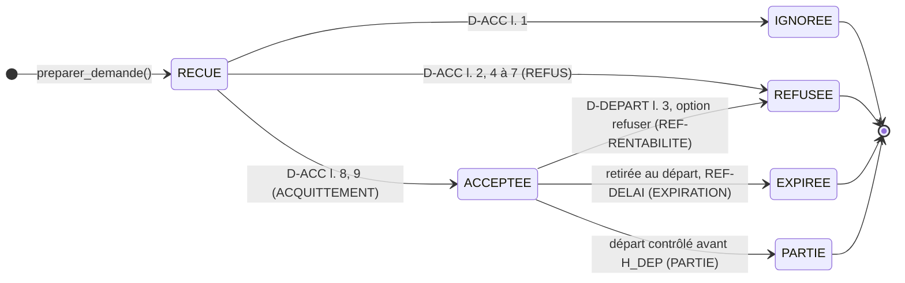
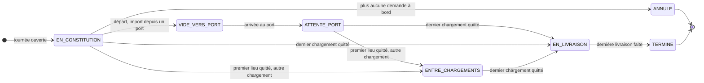
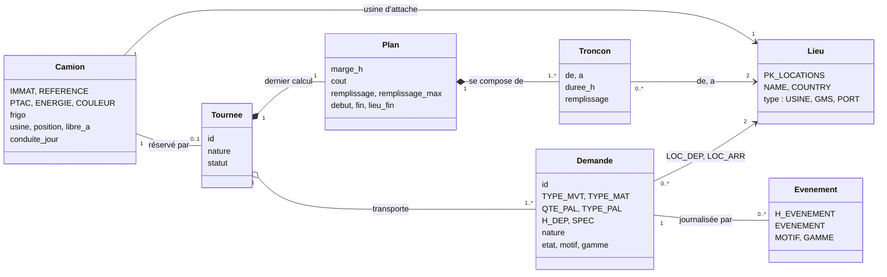

# Processus, règles métier et glossaire — Logistique NORTH

Couches 1 à 3 du standard de documentation (`standard-documentation.md`). État du code de `1 - DEV/` au 20/11/2026. La couche 4 est dans `tracabilite.md`, la couche 5 dans les docstrings du code.

Fil rouge : la demande fictive `D-EX-0421` (export de 6 EPAL de `PF Frais`, usine de Dusseldorf → GMS de Paris, `SPEC = "PTAC=19t"`), suivie dans chaque couche.

*Confidentialité : ce document est lisible par le groupe Contrôle. Aucun chiffre de l'Annexe 2 n'y figure (Annexe 2, confidentielle : voir `3 - Contractualisation/couts.md`).*

## 1. Processus et responsabilités

Le schéma de référence est le pseudo-BPMN du sujet, p. 24 ; il n'est pas redessiné. Chaque élément du couloir « Groupe Logistique » renvoie à nos règles et à nos modules.

| Élément du schéma (couloir « Groupe Logistique ») | Type BPMN | Règles et tables | Module | État |
|---|---|---|---|---|
| Nouvelle demande de transport (couloir ERP) | événement de début | R-COL-01, R-ROB-04 | `collecteur.py` | codé |
| Étude de la faisabilité | tâche | R-PER-01/02, R-VAL-01/02, R-FLO-01, R-SPEC-01, R-FRA-01/02, R-CAP-01, R-DEL-01, R-CON-01 | `regles.py`, `flotte.py`, `planification.py` | codé, testé |
| « Transport réalisable ? » | passerelle exclusive | D-ACC | `decision.py` | codé, testé |
| Calcul du prix du trajet | tâche | R-DUR-01, R-GAM, R-SPEC-02 | `planification.py` (`attribuer_gamme`, `prix_prestation`) | codé, testé ; prix écrit seulement avec les taux de l'Annexe 2 |
| « Prix acceptable par Garden Food ? » | passerelle exclusive | D-PRIX | — | non couvert (question A2 : aucun prix n'est envoyé avant l'acquittement) |
| Planification, ordonnancement des transports | tâche | D-DEPART, R-RENT-01, R-OPT-01 à 04, R-DEL-01, R-CON-01 | `planification.py`, `decision.py` | codé, testé |
| Demande de transport acquittée | événement de fin | journal ; tables `LOG_NORTH_*` ; tables du Contrôle `TRACABILITE_COMMANDE` / `TRACABILITE_TRAJET` (R-CTL-01, D-JUSTIF) | `tracabilite.py`, `archivage.py`, `tracabilite_controle.py` | codés, testés ; tables du Contrôle testées sur une base PostgreSQL locale, pas encore sur la VM ; valeurs à confirmer avec le Contrôle (A1) |
| Suivi des indicateurs (hors schéma) | — | R-KPI-TA, R-KPI-TR, R-GAM | `audit.py`, `tableau_bord.py` | codé, testé |
| Exploitation de la chaîne sur la VM (hors schéma) | — | R-ROB-01 à R-ROB-07 | `nord.sh` (`audit` = production), `robustesse.py`, `journalisation.py`, `moteur.py`, `collecteur.py` | codé, testé ; mode audit pas encore lancé sur la VM |

`D-EX-0421` traverse : collecte, faisabilité, D-ACC, gamme et prix, D-DEPART, acquittement.

### Matrice RACI

R réalise · A répond du résultat (un seul par ligne) · C consulté avant · I informé après. Entre groupes, « C » est une négociation : les données ne passent que par la table traçabilité.

| Activité | Équipe NORTH | Groupe Contrôle | DSI | Autres groupes Logistique |
|---|---|---|---|---|
| Collecter les demandes ERP en continu | R, A | I | | |
| Faire tourner la chaîne pendant l'audit (`nord.sh audit`, R-ROB-05) | R, A | I | C (VM, base) | |
| Décider : accepter ou refuser (D-ACC) | R, A | I | | |
| Regrouper les demandes et faire partir les camions (D-DEPART) | R, A | | | |
| Proposer les formules et cibles des indicateurs | R | A | C | |
| Spécifier la table traçabilité | C | R, A | I | C |
| Remplir les tables de traçabilité pour nos commandes (R-CTL-01) | R, A | I | | |
| Créer la table traçabilité et nos tables `LOG_NORTH_*` dans la base | I | C | R, A | I |
| Écrire acquittements, refus, trajets et commandes | R, A | I | | |
| Calculer les indicateurs d'audit (TR, TA, gammes) | C | R, A | I | |
| Suivre nos indicateurs avant l'audit (tableau de bord) | R, A | | | |
| Tenir cette documentation à jour | R, A | C | I | |

## 2. Règles métier

### 2.1 Table D-ACC : décision sur une demande reçue

Politique « première ligne qui correspond ». Implémentée par `decision.traiter_demande()` ; un test par ligne dans `tests/test_decision.py` (`TestDACC`).

| # | NORTH ? | Données valides ? | Un camion tient la SPEC ? | Frais : frigo dans la flotte ? | Plan réalisable ? | Décision | Motif |
|---|---|---|---|---|---|---|---|
| 1 | non | – | – | – | – | Ignorer | aucun, non journalisée |
| 2 | oui | non | – | – | – | Refuser | REF-DONNEES |
| 2b | oui | oui, mais `H_DEP` déjà passée à la lecture (R-VAL-02) | – | – | – | Refuser | REF-EXPIREE |
| 3 | oui | oui | non | – | – | Continuer, gamme abaissée (R-SPEC-02) | — (REF-SPEC seulement si la SPEC redevient bloquante) |
| 4 | oui | oui | – | non | – | Refuser | REF-FRIGO |
| 5 | oui | oui | – | oui / sec | aucun camion libre et adapté | Refuser | REF-CAMION (sec) ou REF-FRIGO (frais) |
| 6 | oui | oui | – | oui / sec | trop tard (R-DEL-01) | Refuser | REF-DELAI |
| 7 | oui | oui | – | oui / sec | trop tard à cause des pauses (R-CON-01) | Refuser | REF-CONDUCTEUR |
| 8 | oui | oui | – | oui / sec | oui, dans une tournée ouverte | Accepter dans la tournée | — |
| 9 | oui | oui | – | oui / sec | oui, avec un camion libre | Accepter dans une nouvelle tournée | — |

Entre les lignes 8 et 9, le moteur garde d'abord un plan dont le camion tient la SPEC, puis le coût marginal le plus bas, puis le remplissage le plus haut (R-OPT-01/02/03).

`D-EX-0421` : un frigo de 19 t ouvert à Dusseldorf avec du frais pour Paris a encore la place → ligne 8, gamme haute si l'allongement reste ≤ 1,1.

### 2.2 Table D-DEPART : la tournée part-elle maintenant ?

Implémentée par `planification.decider_depart()`, évaluée à chaque tick pour chaque tournée ouverte ; tests `TestDDEPART`.

| # | Remplissage au départ du premier lieu de chargement | Marge avant `H_DEP` au-delà de W ? | Décision | Motif |
|---|---|---|---|---|
| 1 | ≥ seuil θ | – | Partir | — |
| 2 | < seuil θ | oui | Attendre d'autres demandes | — |
| 3 | < seuil θ | non (ou plan devenu impossible) | Partir (défaut) ou refuser | REF-RENTABILITE si refus |

θ et W sont des paramètres de politique réglés par rejeu (`hypotheses.SEUIL_DEPART_DEFAUT`, `hypotheses.MARGE_DEPART_H`, options `--seuil` et `--marge`). W est en heures projet.

### 2.3 Machine à états de la demande

Valeurs du champ `etat` de la demande. Chaque transition, sauf l'ignorance, écrit une ligne du journal (nom de l'événement entre parenthèses).

Pour le TA, une demande EXPIREE compte comme refusée. Le moteur ne suit pas la livraison : une demande PARTIE a son heure d'arrivée prévue au journal, pas d'état « livrée ». Après un redémarrage du moteur, les demandes encore ACCEPTEE du lancement précédent passent EXPIREE en base (`archivage.reprendre()`). Les lignes ne sont jamais supprimées par le moteur : elles s'accumulent d'un lancement à l'autre. Pour repartir de tables vides, `python3 archivage.py --reinitialiser`, moteur arrêté (sauvegarde JSON avant les `DELETE`) ; les tables `TRACABILITE_*` du Contrôle ne sont pas concernées.

### 2.4 Machine à états du trajet (`LOG_NORTH_TRAJET.STATUT`)

Calculée par `archivage.statut_trajet()` à partir du statut de la tournée et de son plan.

### 2.5 Catalogue des règles

État : *sujet* (non négociable), *précision* (réponse de l'enseignant), *décision d'équipe*, *proposition* (à valider par le Contrôle). Les identifiants ne sont jamais renumérotés ; ce catalogue remplace celui du 21/10/2026 (`regles-acceptation.docx`, archivé).

| ID | Règle | Source | Motif | État | Exemple |
|---|---|---|---|---|---|
| R-COL-01 | Aucune demande reçue de l'ERP n'est perdue : le message brut est enregistré avant d'être lu, même s'il est illisible. | Sujet p. 12 (pas de renvoi des messages) | — | Sujet | Message tronqué → conservé dans `demandes_AAAA-MM-JJ.jsonl`. |
| R-ROB-01 | Le moteur ne s'arrête pas sur une erreur de données ou de code : une demande en erreur est refusée (ignorée si hors NORTH), une tournée en erreur reste ouverte et est réexaminée au tick suivant, une ligne illisible du CSV est ignorée et comptée. | Exploitation (un moteur relancé perd son état : ses commandes acceptées expirent) | REF-DONNEES | Décision d'équipe du 20/11/2026 | Exception dans D-ACC pour une demande → refus REF-DONNEES, la suivante est décidée. |
| R-ROB-02 | Base injoignable ou lente : délais bornés (connexion 5 s, requête 10 s) ; le moteur garde le dernier référentiel et réessaie chaque minute ; au démarrage, il repart sur la copie `../donnees/referentiels.json`. | Exploitation | — | Décision d'équipe du 20/11/2026 | Base en panne 3 min → décisions sur le référentiel de la dernière lecture. |
| R-ROB-03 | À l'arrêt demandé (`Ctrl+C` ou SIGTERM envoyé par `nord.sh`), chaque service s'arrête proprement : dernière synchronisation des tables `LOG_NORTH_*`, résumé des indicateurs. | Exploitation | — | Décision d'équipe du 20/11/2026 | `nord.sh arreter` → lignes `LOG_NORTH_*` à jour. |
| R-ROB-04 | Le collecteur ne s'arrête que sur demande : une erreur de réception ou d'écriture est signalée et la collecte continue ; le message brut est écrit avant toute lecture du CSV du jour. | Sujet p. 12 (pas de renvoi des messages) ; R-COL-01 | — | Décision d'équipe du 20/11/2026 | CSV du jour abîmé → message brut gardé, demande écrite. |
| R-ROB-05 | Mode audit (production, `nord.sh audit`) : le moteur lit toujours la base, écrit les tables `LOG_NORTH_*` et utilise les fiches de la VM et l'Annexe 2 ; il refuse de démarrer sans elles, sans copie JSON ni référentiel d'exemple (`nord.sh` réessaie toutes les 30 s). En cours d'audit, une panne de la base garde le dernier référentiel lu (R-ROB-02). Le tableau de bord est public sur le VLAN, sans données confidentielles. | Exploitation ; audit de 2 h (sujet) | — | Décision d'équipe du 20/11/2026 | Base injoignable au lancement → « Mode audit refusé », rien n'est arrêté. |
| R-ROB-06 | Aucune erreur silencieuse : une écriture en base (`LOG_NORTH_*`, `TRACABILITE_*`) ou une lecture du référentiel en échec est journalisée au niveau erreur avec le nombre de lignes en attente, comptée (échecs consécutifs, depuis quand, dernière erreur) et visible dans `sante_moteur.json`, sur le tableau de bord (alerte critique) et dans `sh nord.sh etat` ; son rétablissement est annoncé. Chaque opération SQL va au journal `sql.jsonl`. Une table absente est nommée à la première connexion. Une demande non archivable est signalée une fois. Journaux et santé ne bloquent jamais un service (disque plein : console seule). Les tables `LOG_NORTH_*` absentes bloquent `nord.sh audit`. | Exploitation | — | Écritures en échec sans message visible (20/11/2026) | Table `LOG_NORTH_CAMION` absente → « archivage EN ÉCHEC … table absente », tuile rouge sur le tableau de bord ; à sa création → « archivage rétabli après N échec(s) ». |
| R-ROB-07 | Un moteur relancé (plantage, `redemarrer`) ne redonne pas un camion déjà parti : l'état de chaque camion (lieu, heure de fin de la tournée en cours, heures conduites) est écrit à chaque changement dans `../donnees/run/flotte_moteur.json` et repris au démarrage le même jour réel. Un camion en tournée au moment de l'arrêt reste occupé jusqu'à sa fin prévue et repart de son dernier lieu ; un fichier d'un autre jour ou illisible est ignoré (signalé), les camions repartent alors des fiches. | Décision d'équipe du 24/11/2026 (cohérence de `TRACABILITE_TRAJET`) | — | Décision d'équipe | Moteur planté 2 min après le départ de F1 vers Paris : relancé, F1 reste occupé jusqu'à la fin de sa tournée et n'est pas proposé pour une nouvelle demande. |
| R-CTL-01 | Les tables de traçabilité du Contrôle reçoivent nos commandes seulement : une ligne `TRACABILITE_COMMANDE` par commande NORTH décidée (`STATUT` ACCEPTEE ou REFUSEE, une commande partie reste ACCEPTEE avec `H_DEP_R` = heure réelle de départ, une expirée devient REFUSEE ; `ID_ENTRE` = `N` + numéro de la commande chez nous : N1, N2… ; code de refus D-JUSTIF), une ligne `TRACABILITE_TRAJET` par commande partie (camion, type, capacité, prix, SPEC tenues, remplissage). Aucune ligne d'un autre groupe n'est modifiée ; après un redémarrage, nos commandes laissées acceptées sans départ passent refusées (code 4) et la numérotation reprend. | Sujet (table traçabilité, seul canal entre groupes) ; spécification du Contrôle | — | Spécification du Contrôle ; valeurs à confirmer (A1) | `D-EX-0421` refusée REF-DELAI → `STATUT` REFUSEE, `JUSTIF_REFUS` 4. |
| R-PER-01 | Un export est à nous s'il part d'une de nos usines (Amsterdam, Dusseldorf, Manchester). | Sujet p. 20 | — | Sujet | `D-EX-0421` part de l'usine de Dusseldorf → à nous. |
| R-PER-02 | Un import est à nous s'il va d'un port vers une de nos usines. Amsterdam est usine et port : on décide sur `TYPE_DEP` et `TYPE_ARR`, jamais sur `LOC_DEP` seul. | Décision d'équipe (question A3) | — | Proposition | Import Anvers PORT → Manchester USINE : à nous. |
| R-VAL-01 | La demande est exploitable : lieux connus, `QTE_PAL` > 0, types connus, `H_DEP` lisible. | Sujet p. 11 | REF-DONNEES | Proposition | Ville inconnue de `LOCATIONS_NAMES` → refus. |
| R-VAL-02 | Une demande exploitable dont `H_DEP` est déjà passée quand le moteur la lit est refusée pour délai, pas pour données : cas d'une demande reçue par le collecteur pendant un arrêt du moteur et relue dans le CSV du jour au redémarrage, ou envoyée déjà échue par l'ERP. | Spécification du Contrôle (code 4 DELAI : « délai impossible à respecter ») ; décision d'équipe du 24/11/2026 | REF-EXPIREE | Décision d'équipe | Moteur arrêté 20 min, `D-EX-0421` reçue pendant l'arrêt avec `H_DEP` 10 min après réception → refusée REF-EXPIREE, `JUSTIF_REFUS` 4. |
| R-FLO-01 | Un camion est utilisable s'il est rattaché à une usine NORTH et si sa fiche donne un PTAC connu et une énergie. | Sujet p. 13–15 | REF-CAMION | Proposition | Fiche avec PTAC vide → camion écarté. |
| R-FRA-01 | Le frais voyage en camion frigorifique, jamais avec du sec. | Sujet p. 9 | REF-FRIGO | Sujet | `PF Frais` → remorque réfrigérée, tournée « frais ». |
| R-FRA-02 | Pas de produits secs dans un camion frigorifique. | Décision d'équipe du 21/10/2026 | REF-CAMION | Décision d'équipe | Sec, seuls des frigos libres → refus. |
| R-CAP-01 | La part de plancher occupée ne dépasse 100 % sur aucun tronçon : Σ `QTE_PAL` / capacité(PTAC, type), plus une rangée par type de palette supplémentaire. | `TRUCKS_CAPACITY` ; sujet p. 15 ; `methode-contrat.md` §1.1 | REF-CAMION ou REF-FRIGO (le motif REF-CAPACITE du catalogue d'origine n'est jamais émis) | Proposition | 6 EPAL dans un 19 t qui en prend 21 : 29 % du plancher. |
| R-SPEC-01 | On préfère un camion qui respecte chaque exigence SPEC (PTAC, énergie, couleur) ; sinon la demande est quand même prise. | Sujet p. 11 et 21 ; précision du 21/10/2026 | — | Précision | `PTAC=19t` : un 19 t si possible. |
| R-SPEC-02 | Une demande dont la SPEC n'est pas tenue descend d'une gamme. | Sujet p. 21 ; précision du 21/10/2026 | — | Précision | `PTAC=19t` servi par un 26 t → médiane au lieu de haute. |
| R-DEL-01 | Export : le camion quitte le lieu de chargement, chargé, au plus tard à `H_DEP`. Import depuis un port : il quitte sa position à vide vers le port au plus tard à `H_DEP`. Vrai pour chaque demande d'une tournée. | Sujet p. 11–12 ; précision du 21/10/2026 | REF-DELAI | Sujet, précision | `H_DEP` = 14:00 réelle, reçue à 13:51 : 9 h projet pour amener le camion et charger (1 h 47). |
| R-CON-01 | 45 min de pause après 4 h 30 de conduite ; 12 h de conduite par jour au plus, puis 11 h de repos. | Sujet, Annexe 1 (p. 26) | REF-CONDUCTEUR | Sujet | 6 h de route : une pause de 45 min s'ajoute. |
| R-DUR-01 | La durée totale de la commande (trajets, pauses, attente au port, chargements) est estimée avant d'accepter ; elle fixe le coût et la gamme. | Note d'équipe | — | Proposition | — |
| R-RENT-01 | Une tournée ne part que si son remplissage atteint le seuil θ, sauf à l'heure limite d'une demande à bord (D-DEPART). | Sujet p. 20 ; Annexe 2, confidentielle | REF-RENTABILITE (si refus) | Proposition | Tournée à 60 % avec 3 h projet de marge → attendre. |
| R-GAM | Gamme d'une demande partie : haute (0 arrêt intermédiaire, allongement ≤ 1,1), médiane (≤ 1 arrêt, ≤ 1,5), basse (≤ 3 arrêts, ≤ 2,5) ; au-delà, pas de plan. Le prix facturé applique un coefficient par gamme. | Sujet p. 21 ; `methode-contrat.md` §3 | — | Proposition | Livraison directe → haute. |
| R-KPI-TA | TA = demandes NORTH parties à temps / demandes NORTH reçues. | `methode-contrat.md` §1 | — | Proposition | 300 parties sur 352 reçues → 85,2 % (fictif). |
| R-KPI-TR | TR d'une tournée = surface au sol des palettes chargées / surface du camion, au départ du premier lieu de chargement ; TR = moyenne sur les tournées parties. | Précision du 21/10/2026 ; `methode-contrat.md` §1.2 | — | Proposition | 6 EPAL dans un 19 t : 5,76 m² / 20,16 m² = 28,6 %. |
| R-OPT-01 | Parmi les plans réalisables, choisir le moins coûteux (coût marginal). | Note d'équipe | — | Codée | — |
| R-OPT-02 | À coût égal, choisir le plan au remplissage le plus haut. | Note d'équipe ; sujet p. 21 (RSE) | — | Codée | — |
| R-OPT-03 | Regrouper les demandes compatibles (même nature, plancher suffisant), y compris chargées dans des lieux différents. | Note d'équipe ; sujet p. 10 | — | Codée | — |
| R-OPT-04 | Limiter le détour imposé aux demandes déjà à bord. | Note d'équipe | — | Par les seuils de gamme seulement | — |
| R-OPT-05 | Préférer une commande qui permet un retour chargé. | Note d'équipe | — | Non codée | — |
| R-ARB-01 | Ne pas bloquer une commande plus rentable. | Note d'équipe | — | Non codée | — |
| R-CAB-01 | Cabotage et délai de carence. | Sujet, Annexe 1 | — | Non codée (l'Annexe 1 dit qu'EURO-TransFRET change déjà la liste des camions) | — |

Hypothèse de planification **H-PLA-01** : un camion réutilisé après une tournée part de là où il a fini ; pour un import, c'est ce départ-là qui est comparé à `H_DEP`. Les valeurs que le sujet ne fixe pas portent un identifiant de question (A1 à E18) dans `1 - DEV/hypotheses.py`.

### 2.6 Motifs de refus

Le code `JUSTIF_REFUS` est celui des tables du Contrôle (§2.7).

| Motif | Signification | Règle | Écrit par | Code `JUSTIF_REFUS` |
|---|---|---|---|---|
| REF-DONNEES | Demande inexploitable (lieu, quantité, type ou `H_DEP` illisible) ; ou demande dont le traitement a levé une erreur | R-VAL-01, R-ROB-01 | `decision.traiter_demande()`, `moteur.decider_demande()` | 7 |
| REF-EXPIREE | Données valides, `H_DEP` déjà passée quand le moteur lit la demande (reçue pendant un arrêt du moteur) | R-VAL-02 | `decision.traiter_demande()` | 4 |
| REF-SPEC | Aucun camion ne respecte la SPEC ; plus émis depuis le 21/10/2026 | R-SPEC-01 | `decision.traiter_demande()` si `SPEC_BLOQUANTE` | 2 |
| REF-FRIGO | Aucun frigo dans la flotte, ou aucun frigo libre avec la place | R-FRA-01 | `decision.traiter_demande()` | 3 ou 8 (D-JUSTIF) |
| REF-CAMION | Aucun camion sec libre, exploitable et avec la place | R-FLO-01, R-CAP-01, R-FRA-02 | `decision.traiter_demande()` | 3 ou 8 (D-JUSTIF) |
| REF-DELAI | Aucun plan ne part à temps ; ou demande acceptée retirée au départ (expirée) | R-DEL-01 | `decision.traiter_demande()`, `planification.faire_partir()`, `archivage.reprendre()` | 4 |
| REF-CONDUCTEUR | Le plan ne tient que sans pauses ni repos | R-CON-01 | `decision.traiter_demande()` | 4 |
| REF-RENTABILITE | Tournée sous le seuil à l'heure limite, option « refuser » | R-RENT-01 | `moteur.decider_tournee()` | 6 |

### 2.7 Table D-JUSTIF : code de refus pour les tables du Contrôle

Le Contrôle a fixé huit codes de refus (colonne `TRACABILITE_COMMANDE.JUSTIF_REFUS`). Chaque demande refusée ou expirée reçoit le code de la première ligne qui correspond ; une demande acceptée ou partie n'en a pas. Codé par `tracabilite_controle.code_justif()`, un test par ligne (`tests/test_tracabilite_controle.py`, `TestDJustif`).

| Ligne | Motif du moteur | Condition | Code du Contrôle |
|---|---|---|---|
| 1 | REF-DONNEES | — | 7 DONNEES |
| 2 | REF-SPEC | — | 2 SPECIFICITES |
| 3 | REF-CAMION, REF-FRIGO | des camions compatibles étaient libres, aucun n'avait la place (`capacite_seule`) | 3 CAPACITE |
| 4 | REF-CAMION, REF-FRIGO | aucun camion compatible libre (aucun frigo pour du frais, aucun sec pour du sec) | 8 MOYEN |
| 5 | REF-DELAI (refus, expiration, redémarrage), REF-EXPIREE (échéance passée à la lecture), REF-CONDUCTEUR | — | 4 DELAI |
| 6 | REF-RENTABILITE | tournée sous le seuil θ à l'heure limite | 6 REMPLISSAGE |

Jamais produits : 1 GEOGRAPHIE (nous n'écrivons que nos commandes, R-CTL-01) et 5 PRIX (D-PRIX non couverte, question A2). Un motif inconnu donne 7 ; un test vérifie que chaque motif `REF-…` du moteur a sa ligne.

## 3. Glossaire et modèle du domaine

| Terme | Sens | Dans le code |
|---|---|---|
| Heure projet | 1 minute réelle = 1 heure projet. Les dates sont en heure réelle, les durées en heures projet. | `planification.vers_delta()`, suffixe `_h` |
| `H_DEP` | Heure limite, en heure réelle (voir R-DEL-01). | `demande["h_dep"]` |
| SPEC | Exigences du client sur le camion (PTAC, ENR, COL). | `demande["spec"]` |
| Nature | Frais ou sec, d'après `TYPE_MAT`. | `demande["nature"]` |
| Équivalent-plancher | Part du plancher occupée par un chargement, entre 0 et 1 ; sert à l'admissibilité (R-CAP-01). | `regles.equivalent_plancher()` |
| Taux de remplissage | Surface au sol des palettes / surface du camion ; sert à mesurer (R-KPI-TR), au seuil θ et au prix. | `regles.taux_remplissage()`, `plan["remplissage"]` |
| Tournée | Un camion, une nature, une liste de demandes ; chargements (un ou plusieurs lieux) puis livraisons. Statut ouverte, partie ou annulée. Identifiant `T<AAMMJJhhmmss>-<n°>`. | `etat["tournees"]` |
| Trajet | La tournée vue dans la base (`LOG_NORTH_TRAJET`). | `archivage.ligne_trajet()` |
| Plan | Simulation d'une tournée : arrêts, tronçons, heures, gamme par demande, coût, remplissage, marge avant `H_DEP`. | `planification.evaluer_plan()` |
| Tronçon | Trajet entre deux arrêts, chargé ou à vide. | `plan["troncons"]`, événement `TRONCON` |
| Départ contrôlé | L'instant comparé à `H_DEP`. | `suivi["depart_controle"]`, `H_DEP_R` |
| Marge | Temps restant avant le départ au plus tard d'une tournée, en heures projet. | `plan["marge_h"]` |
| θ, W | Seuil de remplissage pour partir ; marge gardée avant le départ au plus tard. | `parametres["seuil"]`, `parametres["marge_h"]` |
| TA | Taux d'acceptation (R-KPI-TA). Refusées et expirées comptent contre. | `tracabilite.calculer_kpi()`, `audit.calculer()` |
| TR | Taux de remplissage du contrat (R-KPI-TR). | idem |
| Gamme | Haute, médiane ou basse (R-GAM, R-SPEC-02). | `suivi["gamme"]`, `demande["gamme"]` |
| Prix de la prestation | Prix facturé pour une demande partie (`methode-contrat.md` §3). | `planification.prix_prestation()`, `COUT_PREST` |
| Journal | Fichier `evenements_*.csv` : une ligne par ACQUITTEMENT, REFUS, DEPART, TRONCON, PARTIE, EXPIRATION. Source de référence. | `tracabilite.noter()` |
| Archivage | Reflet du journal dans nos tables `LOG_NORTH_CAMION`, `LOG_NORTH_TRAJET`, `LOG_NORTH_ARCHIVAGE_COMMANDE`. | `archivage.synchroniser()` |
| Tables de traçabilité du Contrôle | `TRACABILITE_COMMANDE` et `TRACABILITE_TRAJET`, spécifiées par le Contrôle, partagées entre groupes ; nous y écrivons nos commandes seulement (R-CTL-01). | `tracabilite_controle.synchroniser()` |
| Code de refus (`JUSTIF_REFUS`) | Code 1 à 8 du Contrôle, déduit de notre motif `REF-…` (D-JUSTIF). | `tracabilite_controle.code_justif()` |
| Fenêtre d'audit | Période sur laquelle les indicateurs sont calculés (2 h réelles le jour de l'audit). | `audit.calculer()` |
| Mode audit | Lancement de production pour l'audit : base, archivage, fiches de la VM et Annexe 2 obligatoires, aucune source de remplacement (R-ROB-05). | `nord.sh audit`, `moteur.py --audit` |
| Incident | Erreur rattrapée par un garde-fou (R-ROB-01 à 04, 06, 07) : journalisée une fois par minute au plus par famille (les messages masqués sont comptés, annoncés au suivant et écrits au niveau DEBUG), comptée dans le résumé à l'arrêt. | `robustesse.signaler()`, `etat["messages"]` |
| Santé | État courant d'un service, réécrit à chaque tick dans `../donnees/run/sante_<service>.json` : dernier tick ou message, et pour chaque lien avec la base dernier succès, échecs consécutifs, dernière erreur, lignes écrites, en attente, rejetées (R-ROB-06). | `journalisation.ecrire_sante()`, `robustesse.nouvel_etat_bdd()`, `tableau_bord.alertes_sante()` |
| Journal SQL | Un événement par opération sur la base (connexion, lecture, écriture d'un lot, ligne rejetée, reprise) : table, lignes, durée, erreur ; jamais les valeurs des lignes. | `journalisation.evenement_sql()`, `../donnees/logs/sql.jsonl`, `/api/sql` |

### Diagramme de classes (modèle conceptuel)

Dans le code, ces objets sont des dictionnaires qui portent les mêmes noms de champs.

## Sources

Sujet 2026-2027 (p. 9 à 17, 20, 21, 24, Annexes 1 et 2) ; `standard-documentation.md` ; `3 - Contractualisation/methode-contrat.md` ; code de `1 - DEV/`. Pages de présentation : [Pile documentaire NORTH](https://claude.ai/artifact/WwhHYhgT4Jkip186zLZKF9), [Architecture du moteur NORTH](https://claude.ai/artifact/EjLcKZ13a82uCpUaLsTpMp) ; en cas d'écart, ce fichier et le code font foi.
